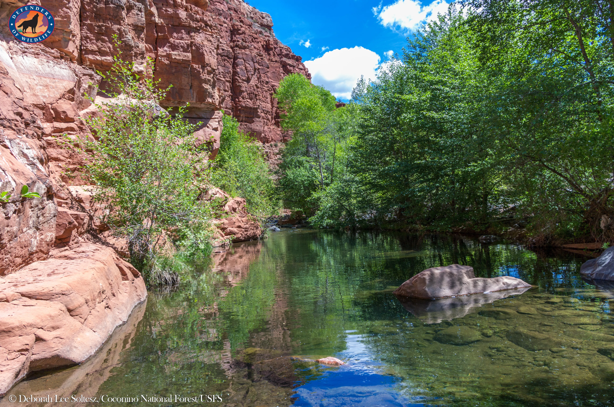
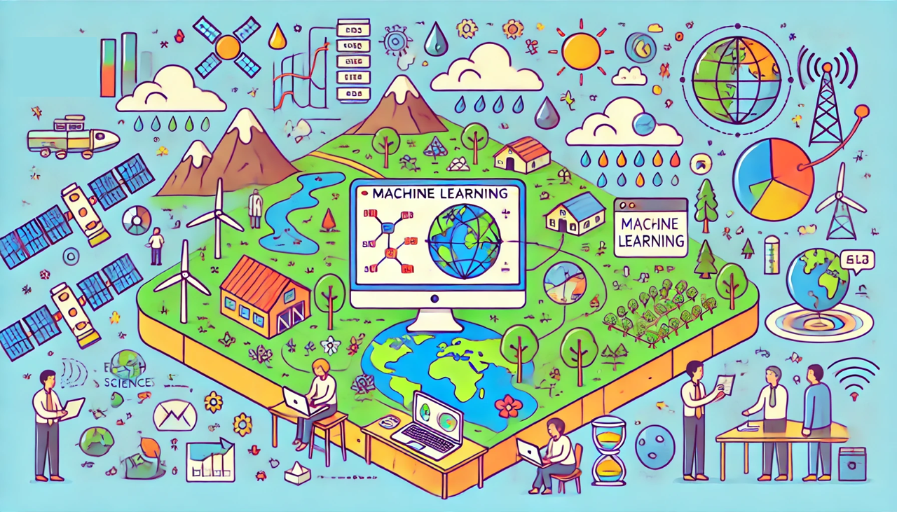
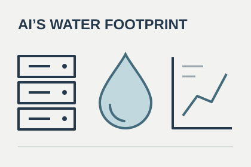
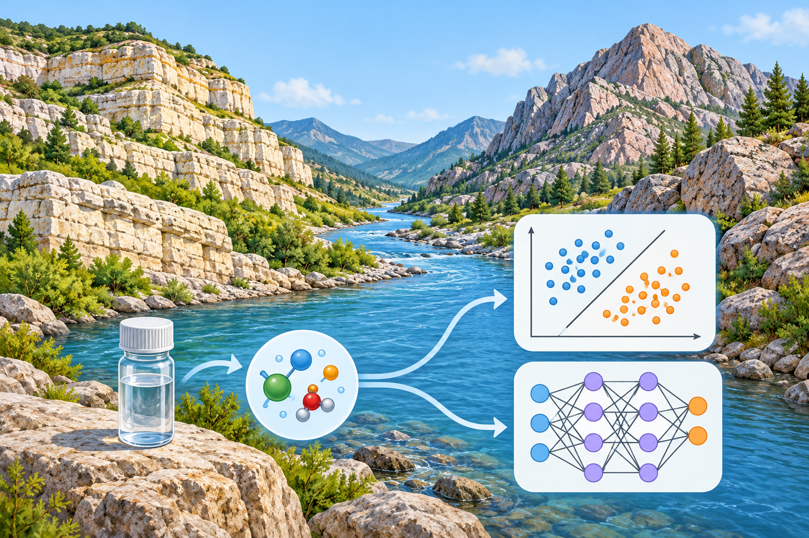

Browse public teaching materials from the WEN Research Group. Syracuse University course pages retain semester-specific schedules and may direct enrolled students to Blackboard.

## Courses

::: {.education-resource}
::: {.resource-image}
{fig-alt="Course artwork for environmental aqueous geochemistry."}
:::
::: {.resource-copy}
### [EAR 419 — Environmental Aqueous Geochemistry](courses/ear-419-environmental-aqueous-geochemistry/index.ipynb)

Study the chemical composition of surface water and groundwater through geochemical calculations, water-sample analysis, and scientific interpretation.

[Syracuse University · 3 credits · In person]{.resource-meta}
:::
:::

::: {.education-resource}
::: {.resource-image}
{fig-alt="Course artwork for machine learning in Earth and environmental sciences."}
:::
::: {.resource-copy}
### [EAR 400 — Machine Learning in Earth and Environmental Sciences](courses/ear-400-ml-ees/index.ipynb)

Use R to organize and visualize environmental data, perform geospatial analysis, and apply machine learning in a project using real data.

[Syracuse University · 3 credits · In person · R]{.resource-meta}
:::
:::

::: {.education-resource}
::: {.resource-image}
{fig-alt="Course artwork for data science in Earth and environmental sciences."}
:::
::: {.resource-copy}
### [Data Science in Earth and Environmental Sciences](courses/hydrolearn-ds-ees/index.ipynb)

Learn R and Python through activities that connect an Earth or environmental science question with a data-analysis workflow and interpretation.

[HydroLearn · Online, self-paced · R and Python]{.resource-meta}
:::
:::

::: {.education-resource}
::: {.resource-image}
{fig-alt="Course artwork about water quality and hydrocarbon development."}
:::
::: {.resource-copy}
### [Environmental Issues Related to Brine Disposal from Hydrocarbon Development](courses/env-hydrocarbon/index.ipynb)

Use public water-quality data to compare stream chemistry upstream and downstream of brine-disposal sites in Pennsylvania.

[SERC · Online, self-paced]{.resource-meta}
:::
:::

## Short learning modules

::: {.education-resource}
::: {.resource-image}
{fig-alt="A server rack and a water drop alongside a chart, representing evidence about AI’s water footprint." style="object-fit: contain;"}
:::
::: {.resource-copy}
### [AI’s Water Footprint: What the Evidence Can and Cannot Tell Us](https://researchguides.library.syr.edu/c.php?g=1534176&p=11594530)

Module 7 of Syracuse University’s [AI Literacy Skills Microcredential](https://researchguides.library.syr.edu/CASAI), co-designed by Tao Wen and Syracuse colleagues. Wen’s module uses peer-reviewed research and a Central New York case study to examine AI’s water use and evaluate environmental claims.

[30–60 minutes · Online, self-paced · College of Arts and Sciences undergraduates]{.resource-meta}
:::
:::

::: {.education-resource}
::: {.resource-image}
{fig-alt="River sampling and contrasting rock types illustrated alongside a linear classifier and a neural network." style="object-position: center bottom;"}
:::
::: {.resource-copy}
### [Can River Chemistry Reveal Catchment Lithology?](https://grid-db.github.io/education/iamg-2026-dl-geochemistry.html)

Compare linear and neural-network classifiers using river chemistry in this PyTorch module by Tao Wen for IAMG 2026.

[40–45 minutes · Python and PyTorch · July 11, 2026]{.resource-meta}
:::
:::
