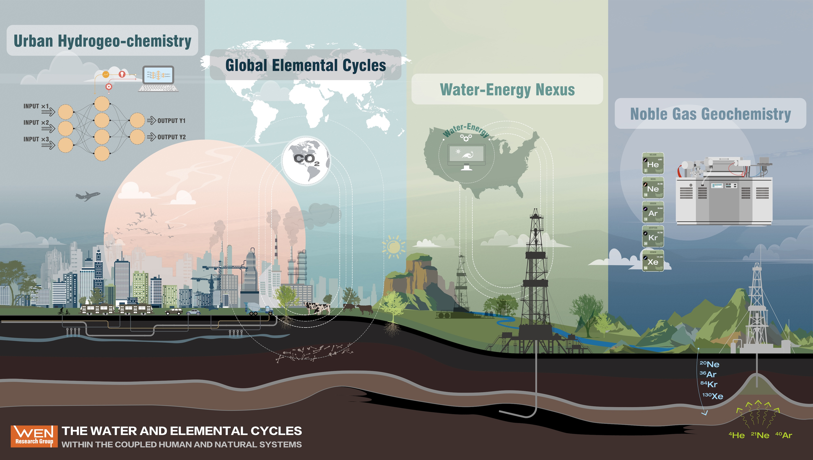

## Research Overview

The Wen Research Group studies how water, elements, and gases move through natural and human-altered landscapes. Our research focuses on water quality, noble gas geochemistry, and water and elemental cycles.

For details about current and upcoming projects, [contact Prof. Wen](/contact.qmd).

::: {#fig-wen-group}
{fig-alt="Thematic illustration of research projects in the WEN Research Group"}

Thematic illustration of research projects in the WEN Research Group.
:::

::: {.figure-credit}
Illustrated by [MENG GRAPHICS LLC](https://xiaomengfu.myportfolio.com){target="_blank"}. Copyright © 2024 Tao Wen. All Rights Reserved.
:::

## Research Themes

::: {.theme-grid}
::: {.theme-card}
### Water Quality in Human-Impacted Systems

We investigate how energy development, urbanization, land use, and legacy infrastructure affect surface water and groundwater chemistry.

Related study: [Radium in shallow aquifers near oil and gas operations (2026)](https://doi.org/10.1021/acs.est.6c05003).
:::

::: {.theme-card}
### Noble Gases in Earth Systems

We use noble gases as tracers and dating tools for fluids, rocks, groundwater, and natural gas systems.

Related study: [Tectonic control on mantle-source helium migration at the southeastern Tibetan Plateau margin (2026)](https://doi.org/10.1130/B38456.1).
:::

::: {.theme-card}
### Global Water and Elemental Cycles

We assess water and elemental fluxes from terrestrial water systems using geochemical observations, hydrological modeling, Earth system perspectives, and data-driven methods.

Related study: [Predicting salinity and alkalinity fluxes of U.S. freshwater in a changing climate (2025)](https://doi.org/10.1016/j.apgeochem.2025.106285).
:::
:::

## Methods and Open Resources

We combine field observations and laboratory geochemistry with environmental data science, geospatial analysis, and machine learning. We also develop open datasets, software, and teaching materials.

### Open Data Projects

::: {#research-project-list}
:::

## Facilities

### Geochemical Instrumentation

WEN Group laboratory resources support water chemistry, stable isotope, and noble gas research. Major instruments include:

* Thermo Fisher Helix SFT and Argus VI mass spectrometers
* Perkin Elmer Avio 200 Inductively Coupled Plasma-Optical Emission Spectrometry (ICP-OES)
* Picarro L2130-i Water Isotope Analyzer with autosampler
* Milli-Q IQ 7005 Ultrapure Water System

The group also works with complementary facilities in the Department of Earth and Environmental Sciences, Syracuse University core laboratories, and neighboring SUNY ESF analytical resources.

### Research Computing Resources

The group uses dedicated workstations and Syracuse University research computing resources for geospatial analysis, machine learning, hydrologic modeling, and large environmental datasets.
